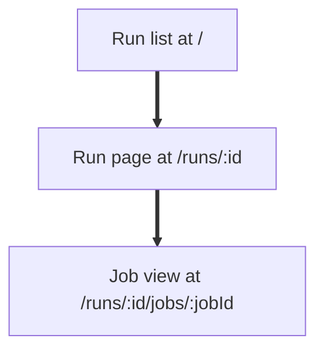
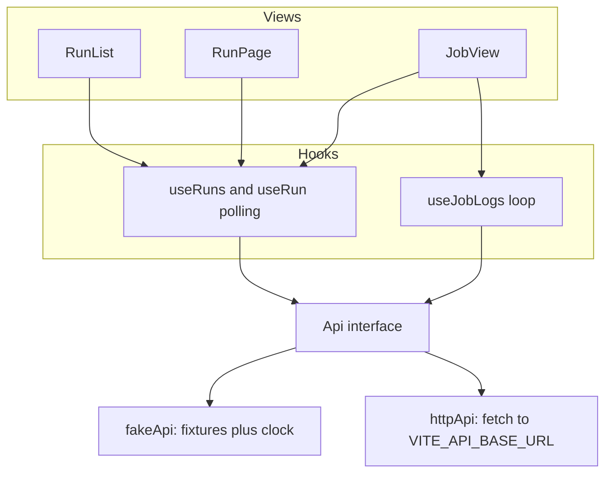
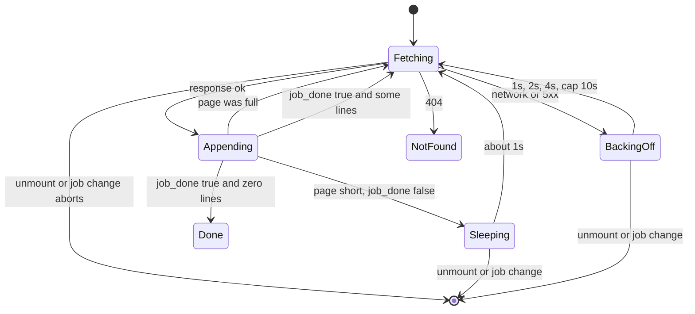

# M6 Actions Frontend - Plan

## Goal Capsule

- **Objective:** At today's demo, anyone watching can open the runner's own web UI, find the run a push just triggered, and watch its job output appear live, in screens that read as GitHub Actions.
- **Means:** A React app in `web/` on Primer React (KTD1), running on a bundled fake API behind one data interface (KTD2, KTD3), with a sequential polling loop for the live tail (KTD4). Paper is a sketchpad for open layout questions, never the source of truth.
- **Product authority:** `docs/SPEC.md` §5.3 and §5.4 are the contract. This plan adds the deltas in R14 to R18 and proposes the SPEC clarifications listed under Risks and Dependencies. The stack is assumed pending the team's confirmation, since `docs/DESIGN.md` §9 leaves it open.
- **Execution profile:** Hackathon pace. Build the riskiest unit first (U3), keep every unit demoable on fake data, and prefer a working screen over a complete one.
- **Stop conditions:** Stop and ask if the team rejects React, if the API's `job_done` or log shape differs from §5.3 in a way the client cannot defend against, or if a unit's tests cannot pass on fake data.
- **Who finishes:** Phil, on a feature branch off `main`, landing through the team's pull request flow. SPEC changes ride in the same PR.
- **Open blockers:** None.

---

## Product Contract

Product Contract preservation: changed, confirmed in planning dialogue. Added R14 to R18 (list and run page refresh, job view route, not found and retry states, placeholder steps). Tightened R9's stop rule and extended R3 with skipped and unknown values. Resolved the deferred Outstanding Questions in place (step expansion in KTD6, fake line release in KTD3, API location in KTD2). R1, R2, R4 to R8, and R10 to R13 unchanged.

### Summary

A GitHub Actions lookalike frontend for the Zig runner with three views: a run list, a run page with status for each job, and a job view with collapsible steps, colored logs, a timestamps toggle, and a live tail. Every view refreshes itself while work is in progress. It runs on its own fake data first and switches to the read API by configuration. Its styling sits on one shared set of style values so a creative restyle can follow the demo.

### Problem Frame

The runner stores logs and run state in Tiger Data and deliberately does not upload logs to GitHub (`docs/DESIGN.md` §5, decision 2). Without this frontend there is nowhere to see a job's output. The demo's success moment, output appearing in our UI within about 2 seconds (`docs/SPEC.md` §8, item 3), lands entirely on M6. M6 also cannot wait on the rest of the system: the API stub (M0) is unbuilt and the runner milestones depend on an undocumented protocol, so the UI has to stand on its own data until they arrive.

### Key Decisions

- **Code first, Paper as a sketchpad.** A working page on fake data is the thing to iterate on at a hackathon; Paper sketches settle open layout questions and are thrown away rather than kept in sync. (session-settled: user-directed, chosen over Paper first then code, a lean Paper board as source of truth, and no Paper at all: the contract is still moving and a polished frame is a second copy to maintain by hand.)
- **The spec's three views only.** Matches the contract and everything the demo slice needs. Governs R1 to R9. (session-settled: user-directed, chosen over adding the workflow filter sidebar in Paper or in code: the runs endpoint cannot filter by workflow without a contract change.)
- **Bundled fake data shaped like the API.** The UI is not blocked on M0, and the switch to real data touches no view. Governs R10, R11.
- **Jobs render as status cards, not a dependency graph.** The schema has no field recording which jobs depend on which, so there are no edges to draw. Governs R4.
- **GitHub's look now, a creative restyle later.** The restyle was asked for as a later option, so today's styling must leave room for it. Governs R12, R13.
- **One theme, GitHub's light default.** Dark mode waits for the restyle. Governs R12.
- **React with Vite and TypeScript, on Primer React.** It is the team's own React proposal, Primer React supplies GitHub's status icons, colors, and collapsible sections ready made, and TypeScript lets `web/` and `api/` share one definition of a run, job, and log line. If Primer React's theme setup stalls, keep React and fall back to Primer's stylesheet and icons. Governs R11, R12. (session-settled: user-approved, chosen over plain HTML with Primer's stylesheet: the live tail, collapsing steps, and three routes would all be written by hand.)
- **Every view refreshes itself while work is in progress.** The demo flow shows a run appearing and turning green without a reload, and the spec only defined polling for logs. Governs R14, R15.
- **Minimal error states.** The API arrives late and runs over TLS, so an unknown id and a dropped connection must not blank the screen. Governs R17.

### Requirements

**Run list**

- R1. The run list at `/` shows runs newest first with status icon, workflow, repo, branch, short commit, age, and duration, per `docs/SPEC.md` §5.4.
- R2. Selecting a run opens its run page.
- R3. Every view presents queued, in progress, and completed runs, jobs, and steps, with success, failure, cancelled, and skipped conclusions, using GitHub's icons and colors, and shows any other value with a neutral icon and its raw label.
- R14. While the list is open it refreshes about every 3 seconds, so a new run appears at the top and status icons update without a reload.

**Run page**

- R4. The run page at `/runs/:id` shows the run's workflow, branch, commit, event, status, and duration, and each job as a card with its status and duration, in the order the API returns them.
- R5. Selecting a job opens the job view for that job.
- R15. While the run is not completed, the run page and the job view refetch the run about every 2 seconds, so job and step status and durations update in place, and stop once the run completes.

**Job view**

- R6. Steps render as a collapsible list with each step's status and duration, and each log line appears under the step its step number names.
- R7. Log lines render their ANSI colors, which the store keeps intact (`docs/SPEC.md` §4).
- R8. A timestamps toggle shows or hides each log line's time.
- R9. While a job is in progress, the view asks for lines after the last one shown about once a second, appends them in order without gaps or duplicates, and stops asking only after the API reports the job done and a request returns no new lines (`docs/SPEC.md` §5.3).
- R16. The job view lives at `/runs/:runId/jobs/:jobId`, so a job can be linked to directly and reloaded.
- R18. A log line whose step number has no step row yet appears under a placeholder step named by its number, replaced when the step row arrives.

**Errors**

- R17. An unknown run or job id shows a not found state, and a failed request shows a retry notice while keeping any rows or lines already on screen.

**Data**

- R10. The frontend ships with fake data shaped exactly like the §5.3 responses, covering at least one successful run, one failed run, one queued run, and one in progress job whose lines arrive over time.
- R11. Pointing the frontend at the real read API is a configuration change with no change to any view.

**Look**

- R12. The views match the GitHub Actions light theme, built on GitHub's open source design system.
- R13. Colors, type, and spacing come from one shared set of named style values, so a later restyle changes that set rather than each screen.

### Key Flows



- F1. Watching a demo run
  - **Trigger:** A push starts a workflow on the runner.
  - **Steps:** The viewer opens the run list and sees the new run at the top, in progress. They open it, then open its job. Log lines appear under the running step as they are produced. When the job finishes, the tail stops and the step, job, and run show their final conclusion.
  - **Covered by:** R1, R2, R4, R5, R6, R9, R14, R15

### Acceptance Examples

- AE1. **Covers R9.** **Given** a job in progress with lines 1 to 40 shown, **when** the next poll returns lines 41 to 45, **then** they append after line 40 in order and no line appears twice.
- AE2. **Covers R9, R15.** **Given** a job in progress, **when** a poll reports the job done and the next request returns no lines, **then** polling stops and the job and its steps show their final conclusion without a page reload.
- AE3. **Covers R9.** **Given** a job that already completed, **when** the viewer opens it, **then** all its lines load and the view does not keep polling.
- AE4. **Covers R4.** **Given** a run with three jobs, **when** the run page loads, **then** three status cards show in API order with no lines connecting them.
- AE5. **Covers R17.** **Given** a job in progress with 40 lines shown, **when** the next poll fails, **then** the 40 lines stay on screen, a retry notice appears, and the next successful poll continues from line 40.
- AE6. **Covers R18.** **Given** the run's steps list has steps 1 and 2, **when** a log line for step 3 arrives, **then** it appears under a placeholder named "Step 3", and that placeholder takes the real name and status on the next run refetch.

### Success Criteria

- Output produced by a running job appears in the job view within about 2 seconds (`docs/SPEC.md` §8, item 3).
- Someone who uses GitHub Actions recognizes all three views and can navigate them without explanation.
- The full F1 flow works on fake data alone, before M0 exists.

### Scope Boundaries

**Deferred for later**

- The creative restyle and dark mode.
- The workflow filter sidebar.
- A true job dependency graph, which needs the team to add a dependency field to the contract.
- Loading older runs past the first page, although the API supports it.
- Moving the live tail from polling to streaming (`docs/DESIGN.md` §5, decision 6).
- Log search, line permalinks, `::group::` folding inside a step, and `##[error]` line highlighting.
- Pausing polls while the browser tab is hidden.
- Serving deep links such as `/runs/12` from the production server, which needs that server to return the app page for every non API path.

**Considered and not built**

- Virtualized log rendering. Collapsed steps mount no lines, demo logs are small, and virtualization breaks browser find. Revisit if one step passes about five thousand lines.
- A data fetching library for the run list and run page. Plain fetch in a hook is less to learn, and the tail's cursor pattern does not fit a refetch interval model.

**Outside this work**

- Login or any access control (`docs/DESIGN.md` §3).
- Any action that changes state, such as rerun or cancel. The API is read only.
- Reading data from GitHub itself.

### Dependencies / Assumptions

- The team confirms the stack in the React decision above; until then it is an assumption, confirmed in parallel with the build.
- M0's API stub arrives later; the frontend does not wait for it (R10).
- Paper's desktop app is running whenever a sketch is needed, so its connector is available to the agent.
- Work follows the team repo's flow: branches off main, never a push to main, and any SPEC change lands in the same pull request as the code that needs it (`docs/SPEC.md`, opening note).
- Node 20.19 or newer is installed, which Vite 8 requires.

### Sources / Research

- `docs/DESIGN.md` §2 Goals, §3 Non-goals, §5 Key decisions, §8 Milestones (M0, M6, demo target), §9 Open questions.
- `docs/SPEC.md` §2 log flush timing, §4 schema rules for `seq` and ANSI, §5.2 state update timing, §5.3 read API and log response shape, §5.4 frontend pages, §8 definition of done.
- Primer React setup and components: https://primer.style/product/getting-started/react/ and token names in the `@primer/primitives` light theme CSS.
- Vite env variables: https://vite.dev/guide/env-and-mode. Vitest fake timers: https://vitest.dev/guide/mocking/timers. React effects: https://react.dev/learn/synchronizing-with-effects.
- `anser` ANSI parser: https://github.com/IonicaBizau/anser. `wouter` router: https://github.com/molefrog/wouter.

---

## Planning Contract

### Key Technical Decisions

- KTD1. **Primer React 38 with Vite 8, React 19, and TypeScript, hand written layout.** Primer supplies the theme provider, base styles, Octicons, `Label`, and `Spinner`; page layout, run rows, job cards, and step rows are plain CSS classes over Primer's variables, because Primer's heavier widgets (`TreeView`, `Timeline`) have the wrong semantics for this UI. Collapsible steps use native `details` and `summary`. Instantiates the React Key Decision; cites R11, R12. (session-settled: user-approved, chosen over plain HTML with Primer's stylesheet: the live tail, collapsing steps, and three routes would all be written by hand.)
- KTD2. **One `Api` interface, two implementations, selected by `VITE_DATA_SOURCE`.** `fake` serves bundled fixtures, `http` calls `VITE_API_BASE_URL` (default `/api`, proxied by the Vite dev server to the Zig API). Views and hooks see only the interface. Cites R10, R11.
- KTD3. **The fake API derives state from elapsed time, not timers.** Each fake in progress job has a start time; a logs request returns the lines whose release time has passed, honoring `after`, `limit`, `next_after`, and `job_done` exactly as §5.3 describes, and the run request derives step and job status from the same clock. Stateless, so it survives React StrictMode's double mount and behaves like a real server. Cites R10.
- KTD4. **Sequential polling loop with a cursor in a ref.** One async loop per mounted job: fetch, append, sleep about 1 second, repeat. One request is in flight by construction. The cursor is the larger of the previous value and `next_after`, lines with `seq` at or below the last shown are dropped, a full page is followed immediately with no sleep, and the loop ends only when `job_done` is true and a response carried no lines. Each request has an `AbortController`, cancelled on unmount or job change. Failures back off 1s, 2s, 4s, capped at 10s, with a retry notice after three in a row; a 404 is terminal. Cites R9, R17.
- KTD5. **ANSI through `anser`'s JSON output, rendered as React spans.** No raw HTML is ever injected, so untrusted log text cannot run as markup. The 16 basic colors map to tokens so a restyle can recolor logs; 256 color and truecolor fall back to inline RGB. Color state resets per line, as GitHub does. Cites R7, R13.
- KTD6. **Step expansion follows GitHub.** The running step and the first failed step start open; everything else starts closed. When nothing is running or failed, all steps start closed. Resolves the brainstorm's deferred question. Cites R6.
- KTD7. **Our own token layer over Primer's variables.** `web/src/styles/tokens.css` defines `--ar-*` names that alias Primer's `--fgColor-*`, `--bgColor-*`, `--borderColor-*`, `--fontStack-*`, and `--base-size-*` variables, plus an ANSI palette. Component CSS uses only `--ar-*` names; no hex or pixel literal appears outside `tokens.css`, enforced by a grep in the Verification Contract. Cites R13.
- KTD8. **`wouter` for routing.** Three routes with no data loading concepts, about 2 KB, no React or Node floor. React Router 8 works too but brings a larger surface for no gain here. Cites R2, R5, R16.
- KTD9. **Tests on Vitest with jsdom and Testing Library, fake timers for every poll.** The `Api` is injected through React context so tests pass a scripted fake rather than mocking `fetch`. `vi.advanceTimersByTimeAsync` drives the loop. Pure functions (status mapping, ANSI parsing, cursor merge, duration formatting) carry the cheapest and most reliable coverage.

### High-Level Technical Design

Components and data flow. Views never touch transport directly.



The log polling loop (KTD4), one instance per mounted job view.



### Output Structure

```
web/
  index.html
  package.json
  vite.config.ts            dev proxy for /api, vitest config
  tsconfig.json
  .env                      VITE_DATA_SOURCE=fake
  .env.example              documents both variables
  README.md
  src/
    main.tsx                Primer theme, tokens.css, router, Api provider
    App.tsx                 routes
    vite-env.d.ts
    api/
      types.ts              Run, Job, Step, LogLine, LogsResponse (snake_case, §5.3)
      Api.ts                the interface
      httpApi.ts
      fakeApi.ts            clock driven release
      fixtures/             one file per fake run
      ApiContext.tsx        provider and useApi
      index.ts              picks the implementation from env
    hooks/
      useRuns.ts            list polling
      useRun.ts             run polling until completed
      useJobLogs.ts         the tail loop
    lib/
      statusVisual.ts       status plus conclusion to icon, color token, label
      format.ts             duration, age, short sha
      ansi.ts               anser JSON to spans, color to token map
    styles/
      tokens.css
      global.css
    views/
      RunList.tsx
      RunPage.tsx
      JobView.tsx
    components/
      StatusIcon.tsx
      StepList.tsx          details and summary per step
      LogLine.tsx           memoized, keyed by seq
      JobToolbar.tsx        timestamps toggle, follow button
      NotFound.tsx
      RetryNotice.tsx
    test/
      setup.ts
      scriptedApi.ts        a controllable Api for tests
```

### Assumptions

- The API returns `next_after` equal to `after` on an empty page. The client guards with a max either way.
- The API's default `limit` is unknown, so the client always sends `limit=1000`.
- Any 404 from the runs or logs endpoints means not found. The spec defines no error body.
- Step numbers in log lines can run ahead of step rows, since steps upsert at start and end while logs flush every 500 ms (`docs/SPEC.md` §2, §5.2).

---

## Implementation Units

### U1. Scaffold the web app

- **Goal:** A running Vite app at `web/` with Primer's light theme, our token layer, three empty routes, and the data source switch wired, so every later unit lands into a page that already renders.
- **Requirements:** R12, R13, R16
- **Dependencies:** none
- **Files:** `web/package.json`, `web/vite.config.ts`, `web/tsconfig.json`, `web/index.html`, `web/.env`, `web/.env.example`, `web/src/main.tsx`, `web/src/App.tsx`, `web/src/vite-env.d.ts`, `web/src/styles/tokens.css`, `web/src/styles/global.css`, `web/src/test/setup.ts`
- **Approach:**
  1. Create the Vite React TypeScript project in `web/` and add the dependencies named in KTD1, KTD5, KTD8, KTD9.
  2. In `main.tsx`, import Primer's light theme CSS, then `tokens.css`, then wrap the app in Primer's theme provider and base styles.
  3. Define the `--ar-*` tokens per KTD7, including the ANSI palette, with the no literals rule in a comment at the top.
  4. Register the three routes per R16 with placeholder views.
  5. Configure the dev proxy for `/api` and the Vitest jsdom environment in `vite.config.ts`.
- **Execution note:** Scaffolding; prove it by running the dev server and seeing a styled placeholder at each route, not by unit tests.
- **Patterns to follow:** Primer getting started page (Sources). Keep CSS in plain files, not inline style props, so tokens stay greppable.
- **Test scenarios:** Test expectation: none, this unit is configuration and scaffolding. The Verification Contract's token grep is its check.
- **Verification:** `npm run dev` serves `/`, `/runs/1`, and `/runs/1/jobs/1` with Primer fonts and colors applied, and `npm run build` passes type checking.

### U2. Types, status mapping, formatters, and the fake API

- **Goal:** Everything the views consume exists and is correct before any view is built: the shared types, the `Api` interface, the pure helpers, and a fake implementation that behaves like the real server.
- **Requirements:** R3, R10, R11
- **Dependencies:** U1
- **Files:** `web/src/api/types.ts`, `web/src/api/Api.ts`, `web/src/api/fakeApi.ts`, `web/src/api/fixtures/*.ts`, `web/src/api/ApiContext.tsx`, `web/src/api/index.ts`, `web/src/lib/statusVisual.ts`, `web/src/lib/format.ts`, `web/src/test/scriptedApi.ts`, tests beside each module as `*.test.ts`
- **Approach:**
  1. Types mirror §5.3 column names exactly, snake_case, with nullable fields typed as such.
  2. `Api` exposes `listRuns`, `getRun`, and `getLogs(jobId, after, limit, signal)`.
  3. `statusVisual(status, conclusion)` returns icon, color token, and label, with the fallback R3 requires.
  4. `format.ts` holds duration ("1m 12s"), age, and short sha, clamping negative durations to zero. Run duration for an in progress run is now minus `created_at`, since runs have no `started_at`.
  5. `fakeApi` implements KTD3. Fixtures: one successful run, one failed run with stderr lines and a skipped step, one queued run, one cancelled run, and one in progress run whose job releases about two lines a second, with one line for a step number that has no step row and one step with zero lines.
  6. `scriptedApi` is a test double whose responses tests push one at a time.
- **Patterns to follow:** One pure function per concern, no React in `lib/` or `api/`.
- **Test scenarios:**
  - `statusVisual` table: each documented status and conclusion pair returns the expected icon and token; `completed` with a null conclusion and an unknown string both return the neutral fallback with the raw label.
  - Duration formatting for 0 s, 59 s, 61 s, and 3661 s; a negative input formats as 0 s.
  - Fake logs honor `after`: requesting `after=3` returns lines starting at seq 4.
  - Fake logs honor `limit`: a job with 1500 released lines returns 1000 then 500 across two requests, `next_after` advancing each time.
  - Fake logs on an empty page echo `next_after` equal to `after` and `job_done` false while the job runs.
  - Fake `job_done` becomes true only after every line's release time has passed.
  - Fake `getRun` for the in progress fixture reports the step currently releasing lines as `in_progress` and earlier steps as completed.
- **Verification:** All unit tests pass and the fake API's responses satisfy the `LogsResponse` type.

### U3. The live tail hook

- **Goal:** `useJobLogs(jobId)` delivers the lines for a job, live or complete, with the loop semantics of KTD4, and nothing else in the app needs to know how.
- **Requirements:** R9, R17, AE1, AE2, AE3, AE5
- **Dependencies:** U2
- **Files:** `web/src/hooks/useJobLogs.ts`, `web/src/hooks/useJobLogs.test.tsx`
- **Approach:**
  1. One effect keyed on `jobId`. Inside it, the sequential loop from KTD4, with the cursor and a cancelled flag in refs.
  2. Lines live in a reducer; the append action drops any line at or below the last seq.
  3. The hook returns lines, a status (`loading`, `live`, `done`, `notFound`), the current error if any, and the consecutive failure count for the retry notice.
  4. Switching `jobId` resets lines and cursor before the new loop starts.
- **Execution note:** Write the fake timer tests first. This is the riskiest unit, and the tests define the loop more precisely than prose can.
- **Patterns to follow:** React's guidance on synchronizing with effects (Sources). No `setInterval`.
- **Test scenarios:**
  - Covers AE1. Lines 1 to 40 shown, next response carries 41 to 45: all 45 render in order, none twice.
  - A response repeating lines 39 to 42 appends only 41 and 42.
  - Covers AE2. A response with `job_done` true and three lines is followed immediately by another request; that one returns zero lines and status becomes `done` with no further requests after 5 more seconds of fake time.
  - Covers AE3. A completed job with 2500 lines loads in three requests with no sleep between the first two and ends `done`.
  - An empty page while live keeps the cursor and polls again after about 1 second.
  - Covers AE5. A network failure keeps the existing lines, increments the failure count, and the next request uses the same `after`; three failures surface a retry condition; a success resets the count.
  - Backoff timing: failures wait 1 s, 2 s, 4 s, then 10 s between attempts.
  - A 404 sets `notFound` and stops polling.
  - Unmounting mid request aborts it and no state update follows.
  - Changing `jobId` from A to B clears A's lines and starts B at `after=0`.
  - Mounting twice in StrictMode produces one live loop, verified by request count after 3 seconds.
- **Verification:** All hook tests pass with fake timers, and the hook has no dependency on any view.

### U4. Job view

- **Goal:** The demo moment. A job's steps, its log lines in color under each step, a timestamps toggle, and a tail that follows new output, matching GitHub's behavior closely enough to be recognized.
- **Requirements:** R6, R7, R8, R15, R16, R17, R18, AE6
- **Dependencies:** U3
- **Files:** `web/src/views/JobView.tsx`, `web/src/hooks/useRun.ts`, `web/src/lib/ansi.ts`, `web/src/components/StepList.tsx`, `web/src/components/LogLine.tsx`, `web/src/components/JobToolbar.tsx`, `web/src/components/StatusIcon.tsx`, `web/src/components/NotFound.tsx`, `web/src/components/RetryNotice.tsx`, tests beside each as `*.test.tsx`
- **Approach:**
  1. `useRun(runId)` fetches the run and polls it about every 2 seconds until `status` is `completed` (R15). The job view reads its job and steps from it.
  2. Group lines by `step`. A step number without a row renders as a placeholder per R18.
  3. Each step is a `details` element with chevron, status icon, name, and duration, open per KTD6. Collapsed steps render no lines.
  4. `LogLine` is memoized and keyed by `seq`, with a per step line number gutter, an optional timestamp (R8), and spans from `ansi.ts` per KTD5. The timestamps setting persists in `localStorage`.
  5. Follow the tail only while the viewer is within about 24 px of the bottom; otherwise show a "Jump to bottom" button.
  6. Durations for in progress steps tick once a second so they do not look frozen.
  7. `notFound` from either hook renders `NotFound`; three consecutive failures render `RetryNotice` above the log without clearing lines.
- **Patterns to follow:** Native `details` and `summary` for accessibility and free open state; Primer `Label`, `Spinner`, and Octicons for status.
- **Test scenarios:**
  - A completed job renders one step section per step row with its status icon and duration.
  - Covers AE6. A line for step 3 when only steps 1 and 2 exist renders under a "Step 3" placeholder; after a run refetch adds step 3, the placeholder shows the real name.
  - Expansion: the in progress step is open, completed success steps are closed, and the first failed step is open on a failed job.
  - ANSI: a line with a red escape renders a span whose color is the red token; the text `<script>` inside a line renders as literal text.
  - The timestamps toggle shows `ts` on every line when on and hides it when off, and the choice survives a remount.
  - Line numbers restart at 1 in each step.
  - A failed poll shows the retry notice while the previously rendered lines remain in the document.
  - An unknown job id renders the not found state.
- **Verification:** On fake data, opening the in progress job shows lines arriving under the running step, the step turns green on completion, and the tail stops. The view is also checked by eye in the browser against GitHub's job page at desktop width.

### U5. Run list

- **Goal:** The landing page: newest runs first with the right columns and icons, refreshing itself so the demo's new run appears on its own.
- **Requirements:** R1, R2, R3, R14, R17
- **Dependencies:** U2
- **Files:** `web/src/views/RunList.tsx`, `web/src/hooks/useRuns.ts`, `web/src/views/RunList.test.tsx`
- **Approach:**
  1. `useRuns()` fetches the list and polls about every 3 seconds while mounted, cancelling on unmount.
  2. Rows show status icon, workflow, repo, branch, short sha, age, and duration; null fields render blank.
  3. Each row links to `/runs/:id`.
  4. Age and duration recompute on each poll so they do not go stale.
- **Patterns to follow:** GitHub's runs list: a bordered box of rows, status icon left, workflow bold, meta line muted.
- **Test scenarios:**
  - Runs render newest first with the expected columns.
  - A run with null branch and sha renders without crashing and with those cells blank.
  - After 3 seconds of fake time a second request is made, and a new run in its response appears at the top.
  - Clicking a row navigates to that run's page.
  - A failed list request shows the retry notice and keeps the previous rows.
- **Verification:** On fake data, the in progress run appears at the top and its icon changes to success when the fake job finishes, with no reload.

### U6. Run page

- **Goal:** The run's header and one status card per job, refreshing until the run completes, with each card opening the job view.
- **Requirements:** R4, R5, R15, R17, AE4
- **Dependencies:** U4 (shares `useRun`)
- **Files:** `web/src/views/RunPage.tsx`, `web/src/views/RunPage.test.tsx`
- **Approach:**
  1. Header: workflow, branch, short sha, event, status icon, duration.
  2. One card per job in API order with status icon, name, and duration, linking to `/runs/:runId/jobs/:jobId`.
  3. A queued run with no jobs shows "Waiting for a runner" rather than an empty area.
  4. Unknown run id renders `NotFound`.
- **Patterns to follow:** GitHub's run summary page, jobs as a vertical stack of cards on the left.
- **Test scenarios:**
  - Covers AE4. A run with three jobs renders three cards in API order with no connectors between them.
  - A card's status icon updates after a refetch changes the job from `in_progress` to `completed` with `success`.
  - Polling stops once the run is `completed`, verified by request count after 5 more seconds.
  - A queued run with no jobs shows the waiting message.
  - Clicking a card navigates to the job view route.
  - An unknown run id renders the not found state.
- **Verification:** On fake data, the in progress run's card turns green on completion and the page stops refreshing.

### U7. HTTP client and the configuration switch

- **Goal:** The same app runs against the real read API by changing one environment variable, with a contract test that can be pointed at the real API when M0 lands.
- **Requirements:** R11
- **Dependencies:** U2
- **Files:** `web/src/api/httpApi.ts`, `web/src/api/httpApi.test.ts`, `web/src/api/contract.test.ts`, `web/.env.example`, `web/README.md`
- **Approach:**
  1. `httpApi(baseUrl)` implements `Api` with `fetch`, passing the `AbortSignal` through and throwing a typed error carrying the HTTP status so the hook can tell 404 from 5xx.
  2. `api/index.ts` picks `fake` or `http` from `VITE_DATA_SOURCE`, with `VITE_API_BASE_URL` defaulting to `/api`.
  3. `contract.test.ts` runs the same assertions (gapless `seq`, `next_after` echo on an empty page, `job_done` semantics) against `fakeApi` always and against the real API when an environment variable names it.
  4. `web/README.md` documents the two variables, the dev proxy, and how to run against the real API.
- **Patterns to follow:** Vite env variable rules (Sources): only `VITE_` prefixed names reach the browser.
- **Test scenarios:**
  - `getLogs(7, 40, 1000)` requests `/api/jobs/7/logs?after=40&limit=1000`.
  - A 404 response rejects with an error whose status is 404; a network failure rejects with no status.
  - An aborted signal rejects promptly without a state update.
  - The contract test passes against `fakeApi`.
- **Verification:** With `VITE_DATA_SOURCE=http` and the Zig API running, the run list loads real rows; with `fake`, the app behaves exactly as before.

---

## Verification Contract

All commands run from `web/`.

| Check | Command | Proves |
|---|---|---|
| Unit and hook tests | `npm test` (Vitest, run mode) | U2 to U7 test scenarios, including AE1 to AE6 |
| Types and bundle | `npm run build` | TypeScript passes and the app bundles |
| Token discipline | `grep -rnE '#[0-9a-fA-F]{3,8}\b|[0-9]px' src --include='*.css' \| grep -v styles/tokens.css` returns nothing | KTD7, R13 |
| Demo flow on fake data | `npm run dev`, then walk F1 by hand at desktop width | F1, R14, R15, visual match to GitHub |
| Contract against the real API | `npm test` with the real API variable set, once M0 exists | R11 |

No browser automation suite is planned for today; the by hand F1 walk is the acceptance check.

---

## Definition of Done

- Every unit's test scenarios pass under `npm test`, and `npm run build` passes.
- The token grep returns nothing outside `tokens.css`.
- F1 completes on fake data: the in progress run appears in the list, its card turns green on the run page, and its log lines stream under the running step in the job view, all without a reload.
- The job view, run page, and run list each render the not found state for an unknown id and the retry notice on a failed request.
- Switching `VITE_DATA_SOURCE` between `fake` and `http` changes no view code.
- The SPEC clarifications under Risks and Dependencies are either answered in `docs/SPEC.md` in the same pull request or listed in the PR description as open.
- No abandoned experiments remain in the diff: dead components, unused fixtures, and commented out code are removed before the PR opens.
- The work sits on a feature branch off `main` and lands through a pull request, never a direct push to `main`.

---

## Risks and Dependencies

**Contract clarifications to raise with the team** (none blocks the build; the client defends against each)

1. `job_done` meaning. Propose: "the job has finished and no lines with `seq` greater than `next_after` remain." The client stops only after `job_done` and an empty page either way.
2. `next_after` on an empty page should echo `after`. The client takes the larger value either way.
3. Default and maximum `limit`. The client always sends 1000.
4. Error shape for an unknown id. The client treats any 404 as not found.
5. The job view route `/runs/:runId/jobs/:jobId` for `docs/SPEC.md` §5.4.
6. Production serving of deep links: the server must return the app page for non `/api` paths, or the app switches to hash routing.

**Risks**

- The team may not confirm React. Mitigation: ask now; Primer's stylesheet fallback keeps the look if components change.
- Primer React 38's theme setup could stall on first install. Mitigation: KTD1's fallback to Primer CSS and Octicons with hand CSS, which the thin component usage makes cheap.
- The real API may differ from §5.3 in a field name or nullability. Mitigation: the contract test in U7 finds it in one run; types are the single place to fix.
